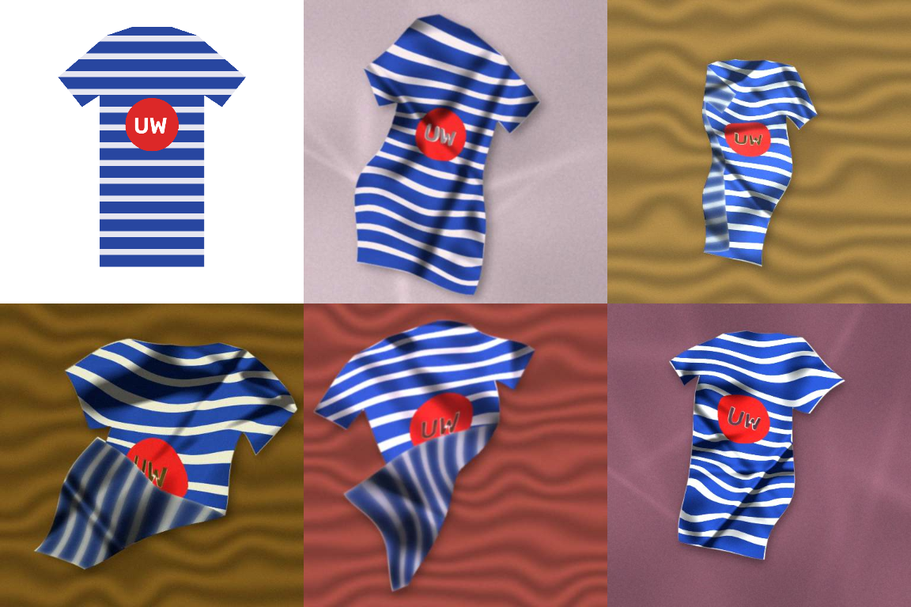

# garment-canon

**Garment canonicalization:** turn a casual photo of a garment that isn't being worn (crumpled,
folded, hanging) into the clean catalog-style image that virtual try-on models expect.
CS 566 course project, fall 2026.



## Status of each piece

| Piece | File | Status |
| --- | --- | --- |
| Procedural crumpling + visible/hidden masks + state labels | `src/garmentcanon/data/crumple_procedural.py` | **Works**, unit-tested |
| Real-photo ground truth (cut out + catalog framing) | `src/garmentcanon/data/real_photos.py`, `scripts/05_prep_real.py` | **Works**, tested on simulated phone photos |
| TryOffDiff network (adapter variant auto-detected from the weight file) | `models/tryoffdiff_arch.py`, `models/components.py` | **Works** on tiny models; real weights untested |
| Fine-tuning (LoRA / full / adapter-only), resumable, chunked | `train/finetune.py`, `models/lora.py` | **Works** end to end on CPU (smoke test) |
| Sampling with classifier-free guidance (Euler or PNDM) | `models/tryoffdiff.py` | **Works** on tiny models |
| Metrics incl. visible/hidden split, try-on in-mask scores | `eval/metrics.py`, `eval/tryon_eval.py` | SSIM + masked L1 tested; LPIPS/DISTS/FID need weights |
| CatVTON try-on | `models/catvton.py` | Matched to the repo's code; needs GPU + weights |
| Generative crumpling (Qwen-Image-Edit, 4-bit) | `data/crumple_generative.py` | Written against diffusers' documented API; needs GPU |
| Colab and CHTC run files | `colab/`, `chtc/` | Written; not yet run |

`python scripts/smoke_test.py` runs the whole pipeline on tiny random models in ~6 minutes on a
CPU. **First GPU run: follow LAUNCH.md.** What changed in the Nov 17 review: `CHANGES.md`.

## Quick start

```bash
pip install -e ".[dev]"                 # CPU-only: crumpling, real-photo prep, tests (torch tests skip)
pytest -q
python scripts/00_crumple_demo.py --images assets/sample_clean.png --n 5

pip install -e ".[gpu]"                 # on Colab / CHTC
```

## Pipeline

| Step | Script | Tier |
| --- | --- | --- |
| Zero-shot benchmark of existing models | `scripts/01_pilot_zero_shot.py` | 1 |
| Build synthetic training pairs | `scripts/02_make_synthetic.py` | 2 |
| Fine-tune TryOffDiff (LoRA) | `scripts/03_finetune.py configs/finetune_lora.yaml` | 2 |
| Canonicalization metrics + downstream try-on | `scripts/04_eval.py canon / tryon / score` | 2 |
| Check real-photo ground truth (CPU) | `scripts/05_prep_real.py` | 1 |

## First things to do
1. Download VITON-HD and run `00_crumple_demo.py --viton ...` to see real garments crumpled.
2. Photograph 5+ of your own garments into `data/real/` (naming rules in `data/real_photos.py`).
3. Follow `LAUNCH.md` for the first GPU run.

## Licenses of the models we build on
TryOffDiff code is SSPL and CatVTON is CC BY-NC-SA 4.0 (non-commercial). Fine for a course
project. A future commercial app would need different base models or permission.

Read `LEARNING.md` alongside the code: it maps every concept to the file that uses it.

## Repo layout
```
configs/        training configs (override any key on the command line: key=value)
src/garmentcanon/
  data/         crumpling (procedural, generative), dataset loaders
  models/       TryOffDiff, CatVTON, LoRA setup
  train/        fine-tuning loop
  eval/         metrics, downstream try-on evaluation
  utils/        config, seeding, image grids
scripts/        numbered pipeline steps
chtc/           HTCondor submit files + job script
colab/          notebook cells
tests/          fast CPU tests
```
